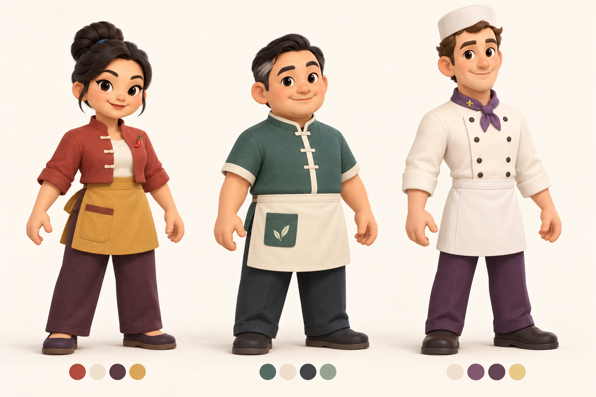
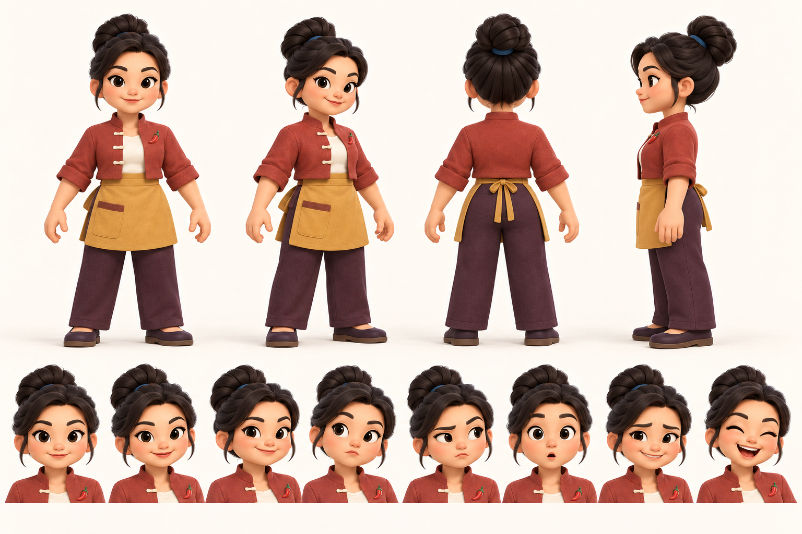
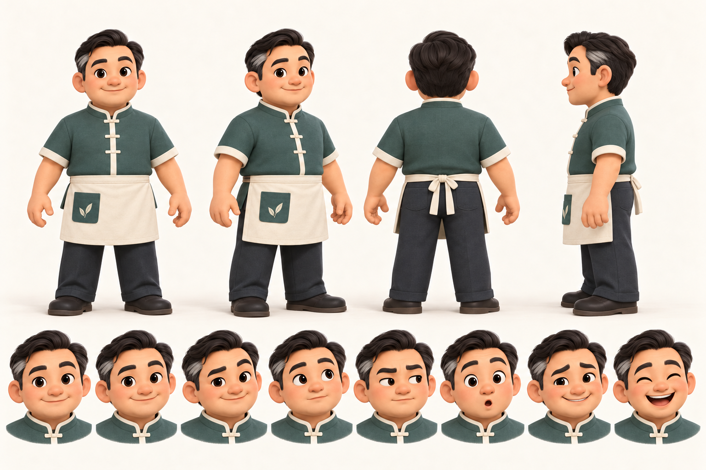
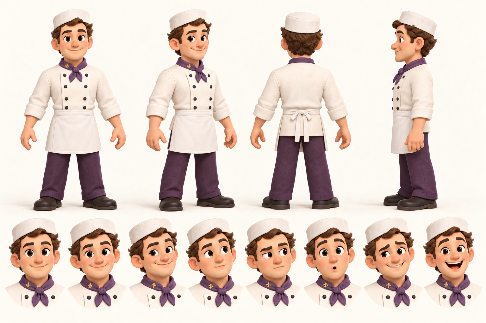

# 2D 概念审阅记录

状态：待用户审批。使用内置 image_gen 生成；提示词保存在 prompts.json。以下四张是本轮工作区交付，尚未输入 Hyper3D。

| 文件 | 内容 | 当前观察 |
|---|---|---|
| 01-lineup-v01.png | 三人配色与风格母版 | 角色身份与配色明确；画面更接近精致动画人物，可按用户偏好再简化到更强的图形化风格 |
| 02-sichuan-turnaround-v02.png | 四川老板娘四视角 + 八表情 | 修正了初版重复侧视角；发髻、胸针、衣着总体延续；“好奇”偏担忧，需在定稿时校准 |
| 03-cantonese-turnaround-v01.png | 粤菜老板四视角 + 八表情 | 发型、灰发、衬衣、围裙总体延续；中性/欢迎差异较小 |
| 04-french-turnaround-v01.png | 法式主厨四视角 + 八表情 | 帽子、领巾与双排扣保持识别性；中性/欢迎差异较小；帽子角度与衣服背面结构需在建模时锁定 |

审阅判断：已人工查看工具输出，四视角和八表情布局齐全，三个角色可区分。未将这些图像标为严格正交投影或完全几何一致；口袋、纽扣、手指和面部比例仍需在单视图整理及 3D 阶段统一。

图像中的表情顺序对应创作意图，不代表每个状态都已准确达标。特别是中性与欢迎差异不足、四川角色好奇状态偏担忧，应在用户确认整体方向后做针对性修订。

本轮批准范围建议包括：整体风格、三人身份与服装、配色、比例方向、表情幅度。批准后先制作干净的单视图，再进行一名角色的 Hyper3D 小样。形象批准不等于骨骼、嘴部、口型或网页效果验收。
